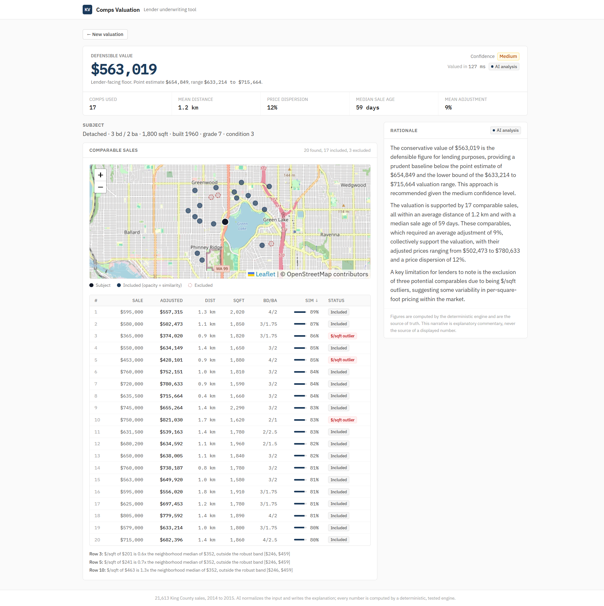
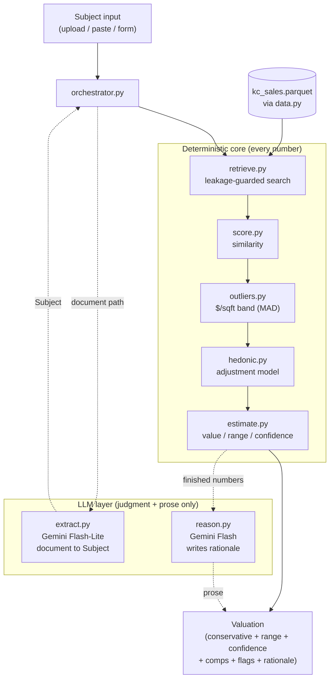
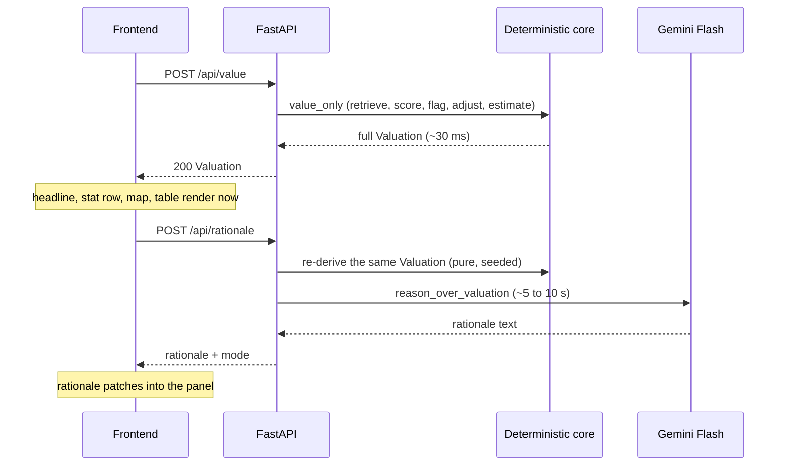

<div align="center">

# Comps Valuation Agent

**A property value an underwriter can defend, in the time it takes to read one comp.**
Turn a messy property document into a conservative comparable-sales valuation,<br />
with the flagged outliers, the comp table and the reasoning needed to sign off on it.

[](https://github.com/PrthD/comps-agent/actions/workflows/ci.yml)
[](docs/eval_report.md)
[](#architecture)

[](https://www.python.org)
[](https://fastapi.tiangolo.com)
[](https://docs.pydantic.dev)
[](https://duckdb.org)
[](https://scikit-learn.org)
[](https://ai.google.dev)
[](https://react.dev)
[](https://www.typescriptlang.org)
[](https://tailwindcss.com)
[](https://vite.dev)
[](https://leafletjs.com)
[](https://www.docker.com)

[**Live demo**](https://comps-agent.vercel.app/) · [**Demo video**](https://www.loom.com/share/2040c600bf3e4e93937461ab204c964b) · [How it works](#how-the-valuation-works) · [Accuracy](#accuracy-and-evaluation) · [Getting started](#getting-started)

</div>

<br />



## Table of contents

- [About](#about)
- [The problem](#the-problem)
- [What it does](#what-it-does)
- [Architecture](#architecture)
- [How the valuation works](#how-the-valuation-works)
- [Agent design](#agent-design)
- [Accuracy and evaluation](#accuracy-and-evaluation)
- [Edge cases handled](#edge-cases-handled)
- [API](#api)
- [Tech stack](#tech-stack)
- [Project structure](#project-structure)
- [Getting started](#getting-started)
- [Testing and quality](#testing-and-quality)
- [Scope and tradeoffs](#scope-and-tradeoffs)
- [What's next](#whats-next)
- [Data and credits](#data-and-credits)

## About

Give it a residential property, as a document, pasted text or a filled form, and it pulls recent
comparable sales, flags the ones outside the normal price-per-sqft band, adjusts the rest for their
differences from the subject, and returns a conservative defensible value with a range, a confidence
level, a map, a comp table and a plain-English rationale.

It is built for an underwriter who needs a number they can stand behind, not a black-box estimate.
Every figure on the screen is produced by pure, tested Python. The language model normalizes messy
input and explains the result; it never touches a number.

## The problem

Every lending deal starts with a comp pull. An underwriter finds 10 to 20 recent comparable sales,
reasons through how each one relates to the subject property, and arrives at a conservative value
they can defend. The work is slow, manual and judgment-heavy. Document intake is messy, comps come
from more than one source, and every comp you exclude needs a reason a lender can defend later.

Hard requirements, taken from a call with KV's problem owner:

| Hard requirement                                                                  | Where it lives in the product                                                   |
| --------------------------------------------------------------------------------- | ------------------------------------------------------------------------------- |
| 10 to 20 comparable sales per valuation                                           | [Retrieval tiers](#architecture) widen by radius and time until the band is hit |
| A conservative value with a range, not a single point estimate                    | [Conservative anchor](#conservative-anchor)                                     |
| Messy document intake (building plans, PDFs, listings), not clean structured data | [Extraction you review](#what-it-does) before anything is valued                |
| Automatic flagging of comps outside the typical price-per-sqft band               | [The $/sqft outlier band](#comp-statuses)                                       |
| Speed is the primary pain                                                         | [Two model calls at most](#agent-design), neither in the path of the number     |

## What it does

1. **Start a valuation** one of three ways: **Upload** a PDF or image, **Paste text** from a listing,
   or **Fill form** directly.
2. **Review the extraction.** On the upload and paste paths the model fills the form for you and
   flags low-confidence fields. It never auto-values from a half-read document.
3. **Place the subject** on the map and click **Value**.
4. **The engine runs**: retrieve comparable sales, score them by similarity, flag $/sqft outliers,
   adjust each comp for its differences from the subject, then produce a conservative value with a
   range and a confidence level.
5. **Read the result**: the conservative value as the headline, the point estimate and range, a
   confidence badge, a map of the subject and its comps, a sortable comp table with exclusion
   reasons, and the rationale.

## Architecture

> [!IMPORTANT]
> **The trust boundary is the whole thesis.** The language model does two things: it normalizes
> messy document input into a structured subject, and it writes the plain-English rationale. It
> never computes or changes a number. Every figure (the conservative value, the range, the
> confidence level, every adjusted comp price) comes from pure, tested functions in
> `backend/app/core/`. That makes the output auditable, reproducible and safe for a lender to rely
> on. With no API key the entire valuation still runs; only the rationale switches from AI-written
> prose to a template.

### System



### Request sequence

The valuation is split into two calls, so the value appears immediately and the slow prose streams
in after it.



## How the valuation works

### Similarity score

Each comp gets a similarity score from 0 to 1: a weighted sum of six subscores. The weights live in
`config.py` and are asserted to sum to 1.0.

| Feature             | Weight |
| ------------------- | ------ |
| Distance            | 0.30   |
| Living area         | 0.20   |
| Recency             | 0.15   |
| Grade and condition | 0.15   |
| Age                 | 0.10   |
| Beds and baths      | 0.10   |

### Comp statuses

Every retrieved comp gets one of four statuses. Excluded comps stay visible in the table with a
reason, but they never drive the value.

| Status               | Meaning                                                                  |
| -------------------- | ------------------------------------------------------------------------ |
| **included**         | Comparable enough to value against                                       |
| **$/sqft outlier**   | Price per sqft falls outside the robust band                             |
| **low similarity**   | Similarity below the 45% floor (`MIN_SIMILARITY_FOR_ESTIMATE`)           |
| **large adjustment** | Needs a hedonic adjustment above the 30% cap (`MAX_ADJUSTMENT_FRACTION`) |

If fewer than 3 comps (`MIN_COMPS_FOR_ESTIMATE`) survive, the engine returns an explicit
"insufficient comparable sales" result instead of valuing off one or two weak comps.

### Conservative anchor

The headline is the conservative value, not the point estimate:

```
conservative = min(point * (1 - margin), P25 of adjusted prices)
```

The margin starts at a 2% base and grows with four factors, then is capped at 25%:

| Factor                  | Contribution                   |
| ----------------------- | ------------------------------ |
| Price dispersion        | coefficient 0.50               |
| Mean comp distance      | 0.01 per km                    |
| Staleness               | 0.02 per mean comp year of age |
| Mean hedonic adjustment | 0.50                           |

A comp set that only fits the subject after large average adjustments produces a visibly lower,
wider-margin value. Taking the minimum with the 25th percentile keeps the headline below the middle
of the comp distribution.

### Confidence tiers

High if every High bound is met, otherwise Medium if every Medium bound is met, otherwise Low.

| Bound               | High     | Medium   |
| ------------------- | -------- | -------- |
| Min comps           | 8        | 5        |
| Max mean distance   | 3.0 km   | 6.0 km   |
| Max dispersion      | 0.12     | 0.20     |
| Max median sale age | 180 days | 365 days |
| Max mean adjustment | 10%      | 18%      |

## Agent design

- **At most two LLM calls per valuation.** Flash-Lite extracts a subject from a document; Flash
  writes the rationale. Speed is the stated pain, and the deterministic core does retrieval,
  scoring and adjustment with no model round-trips, so the value comes back in tens of
  milliseconds. This limit is a deliberate design choice, not a constraint we backed into.
- **One bounded re-query.** If the first comp set is thin or the result is Low confidence, the
  engine widens once by relaxing the property-type filter, with the same leakage guard and the same
  tiers. It adopts the wider set only if that improves coverage without lowering confidence. It
  never loops.
- **Completeness gate.** The backend refuses to value an incomplete subject and returns a distinct
  422 listing the missing fields. A half-read document cannot silently produce a misleading result.
- **Full deterministic fallback.** The entire pipeline runs with no API key. On no key, an empty
  result, or any model failure (timeout, rate limit, empty or off-topic output),
  `generate_rationale` returns the deterministic template and marks the mode accordingly. The
  numbers are identical either way. This is enforced in `orchestrator.py`.

The rationale is fetched separately via `POST /api/rationale` after the value returns, which is why
the conservative value appears in under 100 ms and the prose fills in behind it. See a real run in
[docs/sample_trace.md](docs/sample_trace.md).

## Accuracy and evaluation

The backtest is leave-one-out over a 400-subject random holdout. For each subject it hides the sale
price, values the property as-of its true sale date using only sales strictly before that date (the
leakage guard, asserted per subject), and compares the point estimate to the actual price.

| Metric                          | Value      |
| ------------------------------- | ---------- |
| MdAPE (median absolute % error) | **9.8%**   |
| MAPE (mean)                     | 14.0%      |
| Within 10%                      | 50.1%      |
| Within 20%                      | 77.3%      |
| Valued                          | 383 of 400 |
| Refused (insufficient comps)    | 17 of 400  |

Full report: [docs/eval_report.md](docs/eval_report.md).

What this means for a lender: an MdAPE of 9.8% on a single market with a transparent comps pipeline
is an honest, defensible result. The product is a defensible, explainable valuation at speed, not a
bid to beat a mature nationwide AVM on raw accuracy. The task is different: a number an underwriter
can justify, with every excluded comp explained.

The 17 refusals are a feature. When too few comps are genuinely comparable, the engine declines
rather than producing an indefensible value off weak data. That is the correct behavior for a
conservative lender tool.

## Edge cases handled

- **Sparse comps**: fewer comps and longer distances widen the margin and push confidence toward
  Low (below 5 included comps cannot reach Medium).
- **$/sqft outliers**: detected with a robust median-absolute-deviation band (median plus or minus
  3 MAD, computed on the candidate set, needs at least 4 comps to form a band). Flagged comps are
  excluded from the math but shown in the table and marked on the map with their reason.
- **Large adjustments**: a comp needing a hedonic adjustment above 30% of its sale price is excluded
  with a "large adjustment" status and reason.
- **Heavily-adjusted comp sets**: the mean adjustment across included comps both caps confidence (a
  set above 10% mean adjustment cannot be High, above 18% cannot be Medium) and widens the
  conservative margin.
- **Missing document fields**: the completeness gate returns a 422 with the missing fields and no
  valuation, so an incomplete subject never silently values.
- **Out-of-window as-of date**: a date outside the dataset window (2014-05 to 2015-05) returns no
  comps, with the message that the as-of date is outside the dataset range and should be changed.
- **Insufficient comparable sales**: when fewer than 3 comps survive the quality gate, the engine
  returns an explicit "insufficient comparable sales" result with a breakdown of what was excluded,
  rather than a number.

## API

Five routes, all stateless. The comps store and the hedonic fit load once at startup, never per
request.

| Method | Route            | Purpose                                                              |
| ------ | ---------------- | -------------------------------------------------------------------- |
| `POST` | `/api/value`     | A complete subject to a valuation. Deterministic, no LLM.            |
| `POST` | `/api/rationale` | The same subject to the written rationale, re-derived then reasoned. |
| `POST` | `/api/extract`   | A file or pasted text to a subject with per-field confidence.        |
| `GET`  | `/api/samples`   | Three real King County demo subjects: dense, sparse, outlier-heavy.  |
| `GET`  | `/api/health`    | Readiness and keep-warm probe: status, model availability, comps.    |

`/api/value` and `/api/rationale` both run the completeness gate first, so an incomplete subject
gets a distinct `422 incomplete_subject` listing the missing fields and no valuation.
`/api/rationale` returns the prose plus a `mode` of `agent` or `deterministic`. Extraction is
extraction only: it never chains into a valuation.

## Tech stack

| Layer            | Tools                                                        |
| ---------------- | ------------------------------------------------------------ |
| Language and API | Python 3.11, FastAPI, Pydantic v2                            |
| Valuation core   | scikit-learn (LinearRegression for the hedonic model), NumPy |
| Data store       | DuckDB, bundled King County parquet (~21,600 sales)          |
| LLM              | Gemini Flash (rationale), Gemini Flash-Lite (extraction)     |
| Frontend         | React 19, TypeScript, Tailwind v4, react-leaflet, Vite       |
| Deploy           | Docker, Render (backend), Vercel (frontend)                  |

## Project structure

```
comps-agent/
├── backend/                     FastAPI service
│   ├── app/
│   │   ├── main.py              The five routes, plus the startup load of the comps store
│   │   ├── config.py            Every tunable: weights, tiers, thresholds, margins, model IDs
│   │   ├── schemas.py           Pydantic v2 models at every boundary
│   │   ├── core/                Deterministic core, every number comes from here
│   │   │   ├── data.py          Parquet store loading and property-type derivation
│   │   │   ├── retrieve.py      Leakage-guarded search, haversine, progressive widening
│   │   │   ├── score.py         Six weighted subscores into one similarity
│   │   │   ├── outliers.py      Robust $/sqft band
│   │   │   ├── hedonic.py       Log-price regression, sign-clamped adjustments, time index
│   │   │   └── estimate.py      Point estimate, range, conservative value, confidence
│   │   ├── agent/               LLM layer, judgment and prose only
│   │   │   ├── extract.py       Document, image or text into a Subject
│   │   │   ├── reason.py        Finished numbers into a rationale
│   │   │   └── orchestrator.py  Bounded loop, one re-query, deterministic fallback
│   │   └── eval/backtest.py     Leave-one-out backtest over the holdout
│   ├── data/                    Bundled King County sales parquet
│   ├── scripts/                 Rebuilds that parquet from the public dataset
│   └── tests/                   Core invariants, leakage guard, API contract, agent fallback
├── frontend/                    React single-page app
│   └── src/
│       ├── App.tsx              The input, review and results flow
│       ├── api.ts               Typed client for the five routes
│       ├── components/          InputPanel, SubjectForm, MapPicker, ResultsView,
│       │                        CompMap, CompTable, RationalePanel, Badges
│       └── lib/                 Formatting helpers
├── docs/                        Build brief, evaluation report, sample trace, screenshot
├── Makefile                     Developer commands
├── render.yaml                  Backend deploy (Docker on Render)
└── vercel.json                  Frontend deploy (Vercel)
```

## Getting started

### Prerequisites

- [Python 3.11](https://www.python.org/downloads/), managed with [uv](https://docs.astral.sh/uv/)
- [Node.js](https://nodejs.org/) 20 or newer

### Quick start

```bash
git clone https://github.com/PrthD/comps-agent.git
cd comps-agent

make install        # backend deps via uv, frontend deps via npm
make dev-backend    # FastAPI on http://localhost:8000
make dev-frontend   # Vite on http://localhost:5173  (second terminal)
```

Open [localhost:5173](http://localhost:5173), load a sample from the menu, and click **Value**.

> [!TIP]
> No API key needed. The full valuation runs in deterministic mode out of the box; only the
> rationale is templated instead of AI-written. For agent mode (document extraction and AI-written
> rationales), copy `backend/.env.example` to `backend/.env` and add a
> [Gemini API key](https://aistudio.google.com/apikey).

> [!NOTE]
> The bundled dataset covers King County sales from **May 2014 to May 2015**, so a valuation is made
> as of a date inside that window. The form defaults to 2015-05-01; a date outside the window finds
> no comps and says so.

### Common commands

| Command             | Description                                                 |
| ------------------- | ----------------------------------------------------------- |
| `make install`      | Install backend and frontend dependencies                   |
| `make dev-backend`  | Run the API with reload on port 8000                        |
| `make dev-frontend` | Run the web app on port 5173                                |
| `make test`         | Run the backend and frontend test suites                    |
| `make lint`         | Ruff on the backend, `tsc --noEmit` on the frontend         |
| `make build`        | Production build of the frontend                            |
| `make eval`         | Re-run the leave-one-out backtest and regenerate the report |
| `make data`         | Rebuild the bundled parquet from the public dataset         |
| `make docker-build` | Build the backend container image                           |

### Configuration

Each side reads its own `.env`, copied from the `.env.example` next to it. Every option is
documented there; nothing secret is ever committed.

| Variable                  | Service  | Description                                                                             |
| ------------------------- | -------- | --------------------------------------------------------------------------------------- |
| `GEMINI_API_KEY`          | backend  | Optional. Enables extraction and AI-written rationales. Empty means deterministic mode. |
| `ALLOWED_ORIGINS`         | backend  | Comma-separated origins allowed to call the API. Defaults to `http://localhost:5173`.   |
| `GEMINI_REASONING_MODEL`  | backend  | Optional override. Defaults to `gemini-2.5-flash`.                                      |
| `GEMINI_EXTRACTION_MODEL` | backend  | Optional override. Defaults to `gemini-2.5-flash-lite`.                                 |
| `VITE_API_BASE_URL`       | frontend | Base URL of the backend. Defaults to `http://localhost:8000`.                           |

## Testing and quality

```bash
make test   # backend: pytest    frontend: vitest
make lint   # backend: ruff      frontend: tsc --noEmit
```

Tests are lean and aimed at the core, where the numbers are made: haversine distance, scoring
monotonicity, the leakage guard, outlier detection, the estimate invariants (the estimate sits
inside its range, the conservative value never exceeds the point estimate, more dispersion lowers
confidence), the agent's deterministic fallback, the API contract, and one backtest regression test
that pins the accuracy number. The LLM's prose is deliberately not under test.

Every push and pull request runs the [CI workflow](.github/workflows/ci.yml): ruff and pytest on the
backend, a TypeScript typecheck and vitest on the frontend.

## Scope and tradeoffs

Deliberate cuts, each with a reason:

- **Commercial borrowers**: residential comps are a clean, well-understood workflow; commercial
  valuation is a different model and a different data shape.
- **Multi-market (non-King-County data)**: one market keeps the dataset honest and the backtest
  meaningful. The pipeline itself is geography-agnostic.
- **Persistent deal history**: the service is stateless by design, which keeps deploy and reasoning
  simple. Saved history is a later feature, not a v1 need.
- **Chat interface**: the value is a structured valuation, not a conversation. A form and a results
  page serve the underwriter better.
- **Custom ML AVM**: a black-box model would undercut the whole point. A transparent hedonic plus
  comps pipeline is auditable; that is the product.

## What's next

- Alberta MLS / Teranet data integration (the real KV use case).
- Commercial borrower support.
- Persistent deal history per underwriter.
- A paid API tier for real borrower data (the current free tier may train on inputs).
- Multi-market support.
- Full architectural-drawing parsing.

## Data and credits

- **Comps**: King County house sales, May 2014 to May 2015, from the public CC0
  [`harlfoxem/housesalesprediction`](https://www.kaggle.com/datasets/harlfoxem/housesalesprediction)
  dataset via the [GeoDa Center](https://geodacenter.github.io/data-and-lab/) mirror. Cleaned and
  bundled as a parquet file; `make data` rebuilds it from source.
- **Maps**: [Leaflet](https://leafletjs.com) with [OpenStreetMap](https://www.openstreetmap.org/copyright)
  tiles, no API key required.
